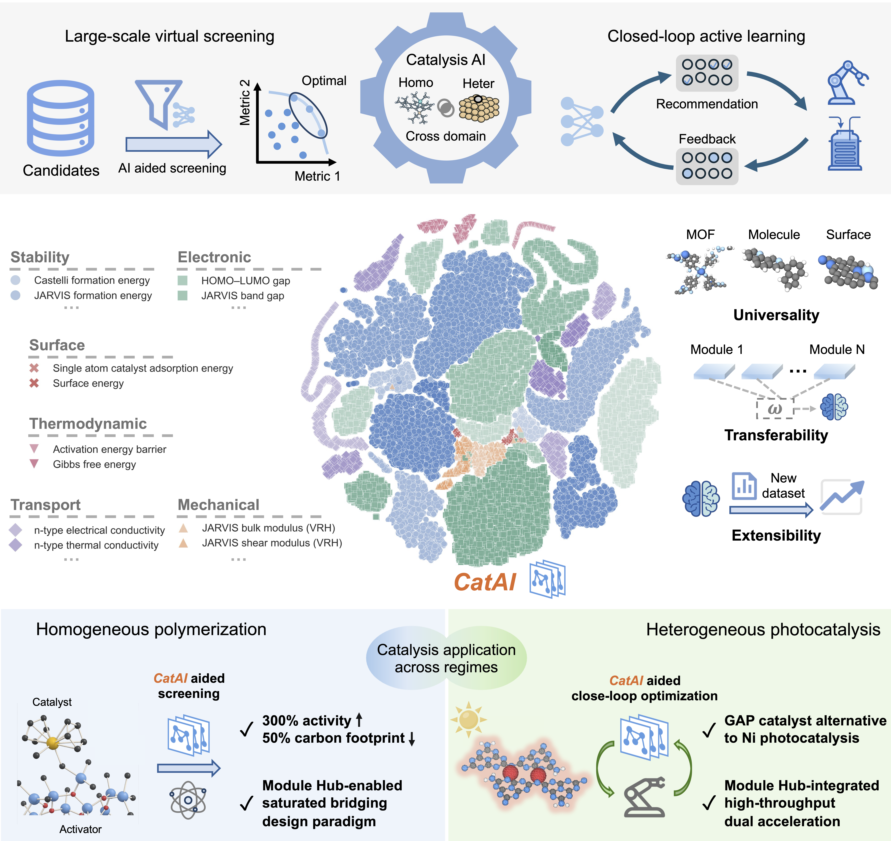

# CatAI: Composable Catalytic Intelligence

**CatAI** is a modular predictive engine designed to bridge theoretical predictions and experimental catalyst design across diverse catalytic regimes. Pre-trained on diverse material systems, CatAI establishes broad universality through module fusion — assembling task-specific predictors from pretrained knowledge modules to enable effective transfer to complex target properties under limited data budgets.

Its modular architecture allows new knowledge modules to be continuously incorporated without retraining existing components, supporting continuous evolution as new tasks emerge. When coupled with complementary tools — including AI-assisted literature mining, automated structure generation, computational workflows, and high-throughput experimental (HTE) platforms — CatAI forms a standardized discovery pipeline from data acquisition through predictive screening to experimental validation.



## Key results

On a comprehensive benchmark of **six datasets** covering prediction of adsorption, desorption, dissociation, and transfer energies:

- **Performance benchmark**: reduces average prediction error by **7.8%** over baseline models.
- **Few-shot benchmark**: improves accuracy by over **30%** in limited-data settings through task-adaptive module fusion.
- **Active learning benchmark**: increases discovery success rate by over **15%** when candidates are proposed under evolving data distributions.

In real-world deployments:

- **Large-scale virtual screening**: identified metallocene catalysts achieving **300% activity enhancement** over commercial standards for industrial polyolefin (POE) polymerization. A saturated bridging architecture was identified as the key design principle, importing heterogeneous-style geometric control into molecular catalyst frameworks.
- **Closed-loop optimization**: integrated with HTE to discover an earth-abundant **copper-based geminal-atom photocatalyst (Cu GAPC)** that embeds molecular-level active-site precision within solid-state supports, achieving excellent yields across a wide variety of chlorine-containing substrates.

## Repository modules

| Directory | Role |
|-----------|------|
| [`Benchmark_performance/`](Benchmark_performance/) | Standard 4-stage performance benchmark: module selection → evaluation → weight optimization → finetune rerun |
| [`Benchmark_few_shot/`](Benchmark_few_shot/) | Same pipeline adapted for few-shot (limited-data) settings |
| [`Benchmark_active/`](Benchmark_active/) | Active learning benchmark under evolving data distributions, with five baseline models and the CatAI backend |
| [`Benchmark_extensible/`](Benchmark_extensible/) | Ablation experiments demonstrating extensibility: random module selection, single-module baselines, and scaling studies |
| [`Large_scale_screening/`](Large_scale_screening/) | Full POE virtual screening application: module selection → screening model training → large-scale inference → ranking |
| [`Closed_loop_Optimization/`](Closed_loop_Optimization/) | Multi-round closed-loop optimization coupling CatAI with HTE for heterogeneous photocatalysis |
| [`Literature_extraction/`](Literature_extraction/) | AI-assisted literature mining tools for building catalysis datasets from published papers |

## Data layout

All benchmark modules read shared resources from `../catai_data/` relative to each module directory:

```text
catai_data/
├── all_modules/          # pretrained CatAI knowledge modules + base checkpoint
│   └── jmp-l.pt          # JMP-L base model
└── catalyst_task/        # benchmark LMDB datasets
    ├── Alloy-GMAE/
    ├── POE_lmdb/
    └── ...
```

Each benchmark writes all logs, checkpoints, embeddings, and results into its own subdirectory. Nothing is written back to `catai_data/`.

## Data download

All data required to reproduce the benchmarks and applications is publicly available on Zenodo:

[](https://doi.org/10.5281/zenodo.19412454)

> Li, W. (2026). *CatAI*. Zenodo. https://doi.org/10.5281/zenodo.19412454

| Archive | Size | Contents |
|---------|------|----------|
| `all_modules.zip` | 20.3 GB | Pretrained CatAI knowledge modules |
| `catalyst_task.zip` | 132.7 MB | Benchmark LMDB datasets (Alloy-GMAE, desorption-oc20, etc.) |
| `pretrain_data.zip` | 1.1 GB | Pretraining data used to train the knowledge modules |
| `other_checkpoints.zip` | 4.2 GB | Additional model checkpoints |

After downloading, extract into the `catai_data/` directory sibling to this repository:

```bash
unzip all_modules.zip   -d ../catai_data/
unzip catalyst_task.zip -d ../catai_data/
```

The resulting layout should match the structure described in [Data layout](#data-layout) above.

## Quick start

Enter any benchmark directory and run:

```bash
cd Benchmark_performance
bash run_all.sh
```

Each directory exposes environment variables for path overrides:

```bash
export CATAI_PYTHON_BIN=$(which python)
export CATAI_DATA_ROOT=../catai_data/catalyst_task
export CATAI_MODULE_HUB_PATH=../catai_data/all_modules
export CATAI_BASE_CHECKPOINT_PATH=../catai_data/all_modules/jmp-l.pt
```

Source `run_common.sh` in any benchmark directory to apply its defaults before running steps manually.

## Repository structure

```text
CatAI/
├── catai_data/                   # shared read-only data (not committed to git)
│   ├── all_modules/              # pretrained knowledge modules
│   └── catalyst_task/            # benchmark datasets
├── Benchmark_performance/
├── Benchmark_few_shot/
├── Benchmark_active/
├── Benchmark_extensible/
├── Large_scale_screening/
├── Closed_loop_Optimization/
└── Literature_extraction/
```

### 1. Benchmark_performance

Standard 4-stage performance benchmark: module selection → performance evaluation → weight optimization → finetune rerun. Evaluates CatAI's module-fusion strategy across six catalytic prediction datasets and demonstrates a **7.8% average MAE reduction** over single-model baselines. See [Benchmark_performance/README_en.md](Benchmark_performance/README_en.md).

### 2. Benchmark_few_shot

Same 4-stage pipeline adapted for limited-data (few-shot) settings. Validates that task-adaptive module fusion remains effective when only a small amount of target-task labeled data is available, achieving over **30% accuracy improvement** versus few-shot baselines. See [Benchmark_few_shot/README_en.md](Benchmark_few_shot/README_en.md).

### 3. Benchmark_active

Active learning benchmark simulating iterative sample acquisition under evolving data distributions. Supports five baseline model backends (`gemnet_oc`, `cgcnn`, `dpp`, `schnet`, `et`) and the CatAI backend. CatAI increases the discovery success rate by over **15%** compared to single-model active learning. See [Benchmark_active/README_en.md](Benchmark_active/README_en.md).

### 4. Benchmark_extensible

Ablation study collection demonstrating CatAI's extensibility: random module selection, single-module baselines, and parameter-scaling studies. New modules can be added to `../catai_data/all_modules/` and immediately composed into pipelines without retraining existing components. See [Benchmark_extensible/README_en.md](Benchmark_extensible/README_en.md).

### 5. Large_scale_screening

Full virtual screening pipeline for industrial polyolefin (POE) polymerization. Connects module selection through screening model training, large-scale inference over thousands of candidates, and final ranking. Key finding: metallocene catalysts with a **saturated bridging architecture** achieve **300% activity enhancement** over commercial standards, importing heterogeneous-style geometric control into molecular catalyst frameworks. See [Large_scale_screening/README_en.md](Large_scale_screening/README_en.md).

### 6. Closed_loop_Optimization

The most end-to-end workflow in CatAI: four sequential rounds of conditional HTE-coupled optimization for heterogeneous photocatalysis. Module selection and weight optimization are performed once at the top level; each subsequent round refines the candidate pool based on experimental feedback. Key finding: discovery of **Cu GAPC**, an earth-abundant copper-based geminal-atom photocatalyst embedding molecular-level active-site precision within solid-state supports, with excellent yields across chlorine-containing substrates. See [Closed_loop_Optimization/README_en.md](Closed_loop_Optimization/README_en.md).

## Notes

- Each module directory contains a `README_en.md` with full step-by-step instructions.
- All outputs (checkpoints, logs, results) are written within each module directory and are not committed to the repository.
